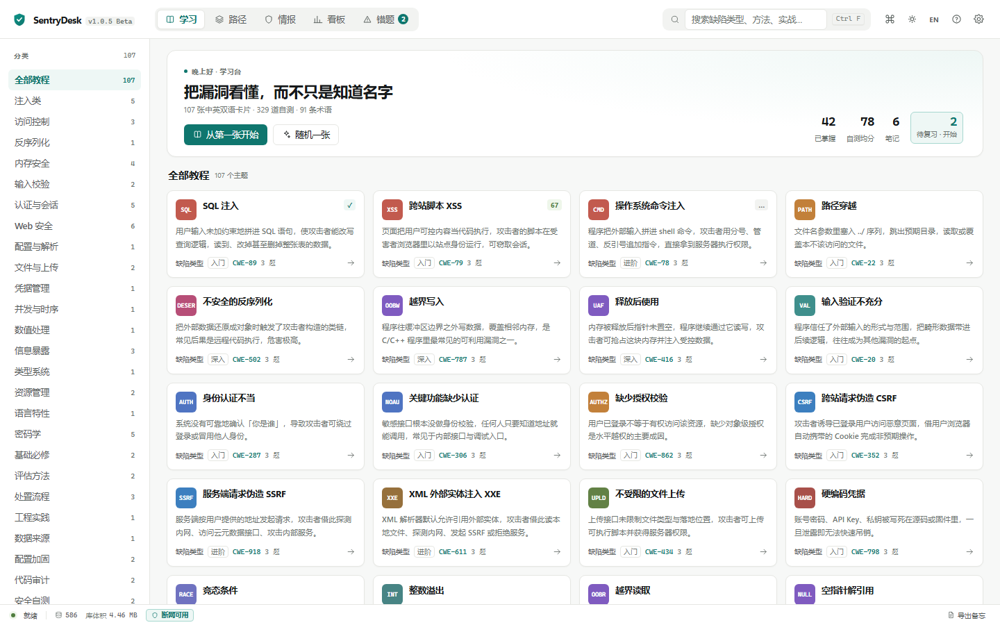
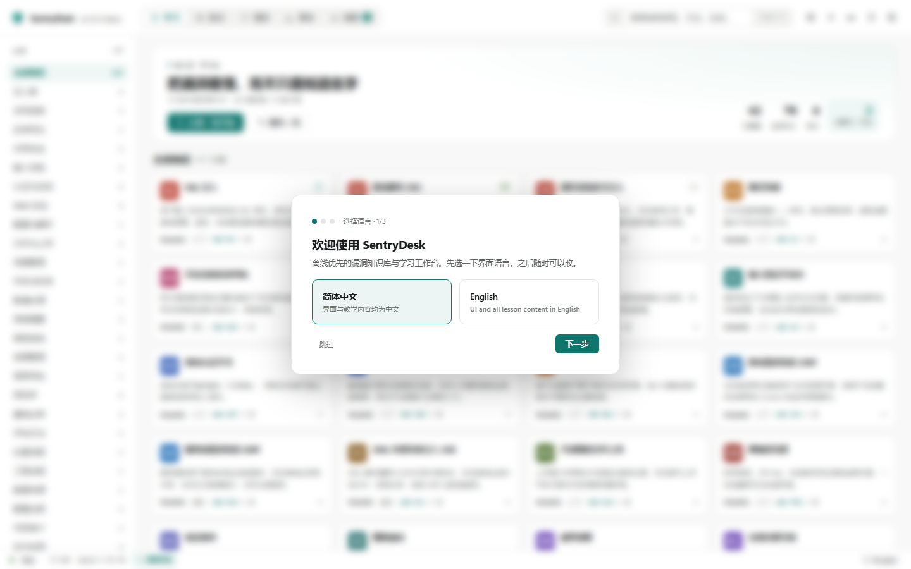
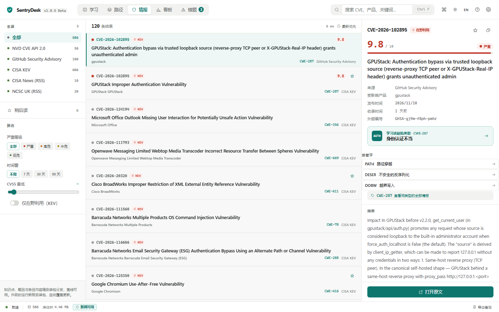
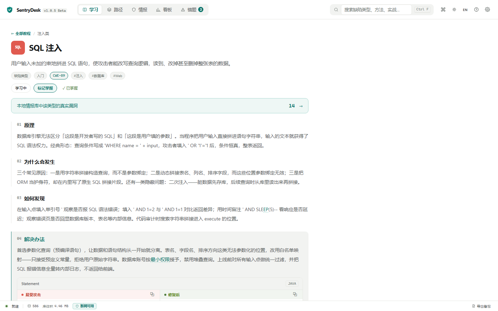
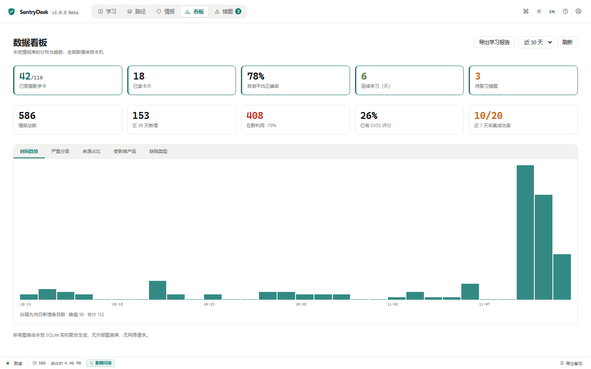
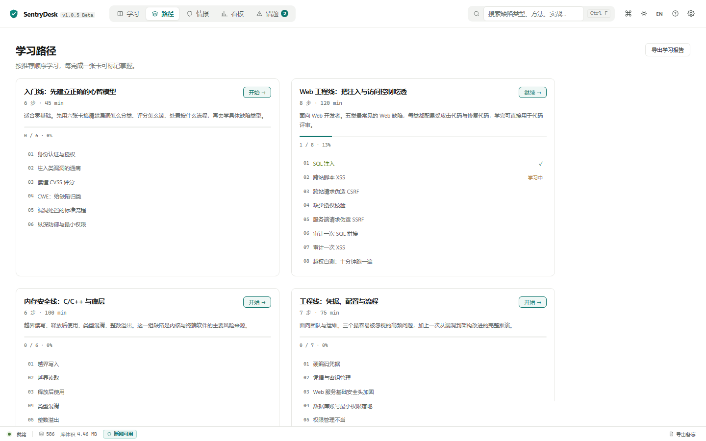
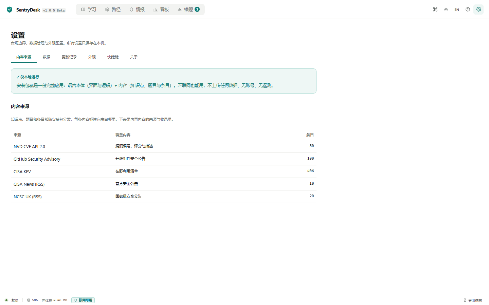

# SentryDesk

[](https://github.com/MenLan-ov/SentryDesk/actions/workflows/ci.yml)

> ## 🏆 参赛作品
>
> 本仓库是 **ISC.AI 2026 创新百强「行业AI应用案例挑战赛」** 参赛作品，
> 方向 **AI+数字安全**，案例名称「使用纳米Work完成安全情报本地聚合解析桌面工具的设计与开发」。
> 作品由单人借助 **纳米Work** 完成全栈实现（Rust 采集解析内核、Vue 界面、SQLite 数据层与全部文档），
> 约 34 小时迭代 24 个可安装版本，代码骨架与文档初稿由纳米Work 产出，人工负责审核、实测与取舍。
>
> | 赛事交付物 | 入口 |
> |---|---|
> | ① 最终作品 | 本仓库 + [v1.1.2 Release](https://github.com/MenLan-ov/SentryDesk/releases/tag/v1.1.2)（4 个资产，可直接安装验证）|
> | ② 案例说明文档 | [案例说明文档](docs/reports/SentryDesk-案例说明文档.md)（五部分，2,454 字）|
> | ③ 过程证明 | [开发日志](docs/开发日志.md)（24 版本逐版）· [评审与升级清单](docs/评审与升级清单.md) · [测试报告](docs/reports/SentryDesk-测试报告-v0.7.5.md) · [版本截图](docs/screenshots/) |
> | ④ 演示视频 | [演示视频（仓库内 MP4）](docs/SentryDesk-演示视频-v1.1.2.mp4) 与 [分镜脚本](docs/演示视频脚本.md)；成片 2:22，覆盖制作过程与最终效果，末尾展示纳米Work 产出物 |
>
> 全程本地运行、断网可用、数据不出机器；只做合规采集公开信息，不提供对外服务。


**离线优先的漏洞知识库与安全学习工作台** —— 把公网情报变成可教学、可自测、可复习的知识资产。

- 🖥️ Windows 桌面应用（Tauri 2 + Rust + Vue 3 + TypeScript）
- 📦 单安装包约 4 MB，安装后约 17 MB，安装即用，**断网可用**
- 🔒 无账号、无遥测、不上传任何数据，全部内容存于本机 SQLite
- 🌏 中英文双语界面与双语教学内容



## 这是什么

SentryDesk 是一个本地优先的安全知识库。安装包内同时包含：

| 组成 | 内容 |
|---|---|
| 情报库 | **2,979 条漏洞条目**（CISA KEV 在野利用清单 + 近期 CVE），随包分发、离线可查 |
| 教学卡 | **110 张**中英双语教学卡（CWE 弱点、安全域、实战实验），每卡附参考来源 |
| 自测题 | **338 道**随卡自测题，答错自动进入错题本 |
| 术语表 | **91 条**安全术语双语对照 |
| 学习路径 | **14 条**岗位视角学习路径（含 ATT&CK、供应链、云原生主题） |

## 核心能力

**1. 情报 → 学习的完整闭环**
情报条目自动关联 CWE 弱点 → 一键跳到对应教学卡 → 学完立即自测 → 错题进入间隔重复复习队列 → 看板追踪进度。一条漏洞新闻可以直接变成一次学习。

**2. 本地优先，离线可用**
SQLite + FTS5 全文检索，毫秒级搜索；WAL 日志 + 内存临时表保证并发与性能；数据库损坏自动隔离重建，绝不白屏。

**3. 合规采集（可选更新）**
内容默认随安装包分发、覆盖安装即更新；内置的采集模块遵守 robots 协议、固定 User-Agent、严格限速，只访问白名单公开源（NVD / GitHub Advisory / CISA）。

## 界面

首次启动有三步引导：选语言 → 认识内容 → 做一道题。



| 情报检索 | 教学卡 | 学习看板 |
|---|---|---|
|  |  |  |

| 学习路径 | 设置与数据来源 |
|---|---|
|  |  |

## 技术架构

```
┌─────────────────────────────────────────────┐
│  Vue 3 + TypeScript 前端（视图层）            │
│  Home / Items / Lessons / Dashboard / Settings│
├─────────────────────────────────────────────┤
│  Tauri 2 IPC（命令层，47 个 command）          │
├─────────────────────────────────────────────┤
│  Rust 业务层                                  │
│  collect（合规采集）· parse（解析引擎）         │
│  db（SQLite/FTS5）· knowledge（教学库）        │
├─────────────────────────────────────────────┤
│  数据层：SQLite（WAL）+ JSON 内置知识库         │
└─────────────────────────────────────────────┘
```

- Rust 约 6200 行，40 个单元测试（`cargo test` 全过）
- 前端约 8000 行，`vue-tsc --noEmit` 零错误
- 安装器：NSIS 自定义模板，安装位置自选、写入受阻自动改道、占用自愈、启动即申请所需权限

## 安装与更新

**安装**：下载 `SentryDesk_x.x.x_x64-setup.exe`，双击运行（会申请一次管理员权限），
装完即含全部内容，离线可用。

**更新**：运行新版安装包即可覆盖更新，学习进度与笔记保留在
`%LOCALAPPDATA%\com.sentrydesk.app`，不受影响。

**便携版**：`SentryDesk_x.x.x_portable.zip` 解压即用，不写注册表。

## 从源码构建

```bash
npm install
npm run build                # 前端产物
cd src-tauri && cargo test   # 单元测试
npx tauri build              # 产出 NSIS 安装包
```

要求：Node 18+、Rust stable、Windows 10/11（WebView2）。

## 数据来源与合规

- [CISA KEV](https://www.cisa.gov/known-exploited-vulnerabilities-catalog)（美国政府作品，公有领域）
- [NVD](https://nvd.nist.gov/)（NIST 公开数据）
- [GitHub Security Advisories](https://github.com/advisories)（CC-BY-4.0）

教学内容为本项目原创撰写，参考来源在每张卡片的 `refs` 字段标注。
详见 [docs/数据来源与合规.md](docs/数据来源与合规.md)。

## 文档

| 文档 | 内容 |
|---|---|
| [docs/开发日志.md](docs/开发日志.md) | **完整开发日志**：v0.1.0 → v1.1.2 全部 24 个版本逐版记录（构建时间、安装包体积、改了什么、为什么改、哪些判断被推翻），另含架构演进、踩坑归档、五层测试体系与实测指标 |
| [docs/发布与更新.md](docs/发布与更新.md) | **发布流程**：两套签名（Authenticode + minisign）、四步发版、`latest.json` 模板、CI 三道关、发布检查清单 |
| [docs/演示脚本.md](docs/演示脚本.md) | 5 分钟现场演示流程 + 预判提问与回答（答辩用） |
| [docs/评审与升级清单.md](docs/评审与升级清单.md) | 自我评审记录：v0.8.7 基线 → v1.1.2 复评 |
| [docs/数据来源与合规.md](docs/数据来源与合规.md) | 五个数据源的许可与采集边界 |
| [ARCHITECTURE.md](ARCHITECTURE.md) | 五层单向依赖、模块职责、数据流与合规约束 |
| [CHANGELOG.md](CHANGELOG.md) | 简版变更记录（一版一条，适合快速浏览） |

> 三份记录的分工：**CHANGELOG** 是一句话摘要；**开发日志**是完整过程与理由；**发布与更新**是操作手册。
## 许可

代码以 [MIT License](LICENSE) 发布。

---

*SentryDesk —— 漏洞情报，不止于阅读。*
